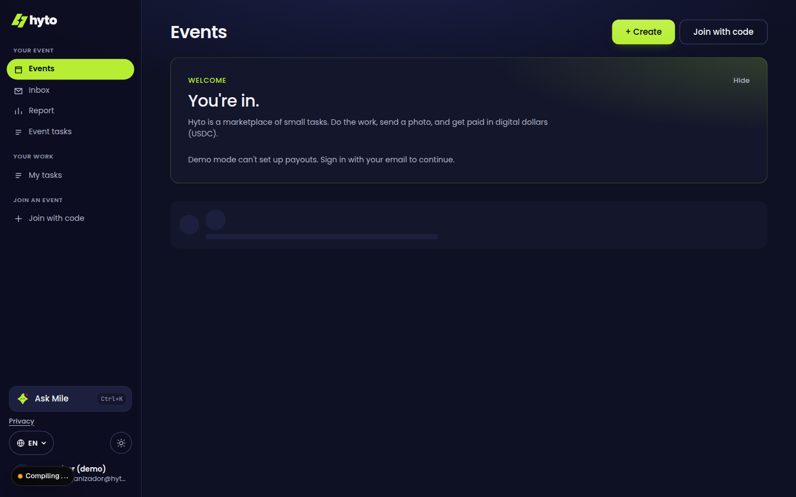
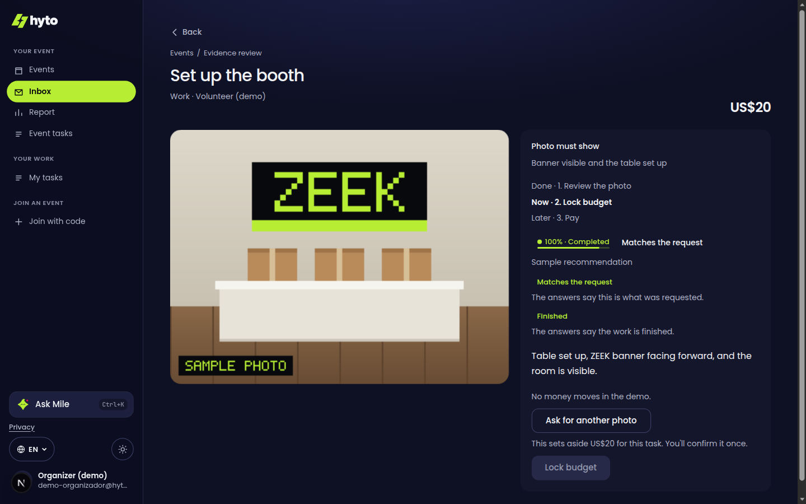
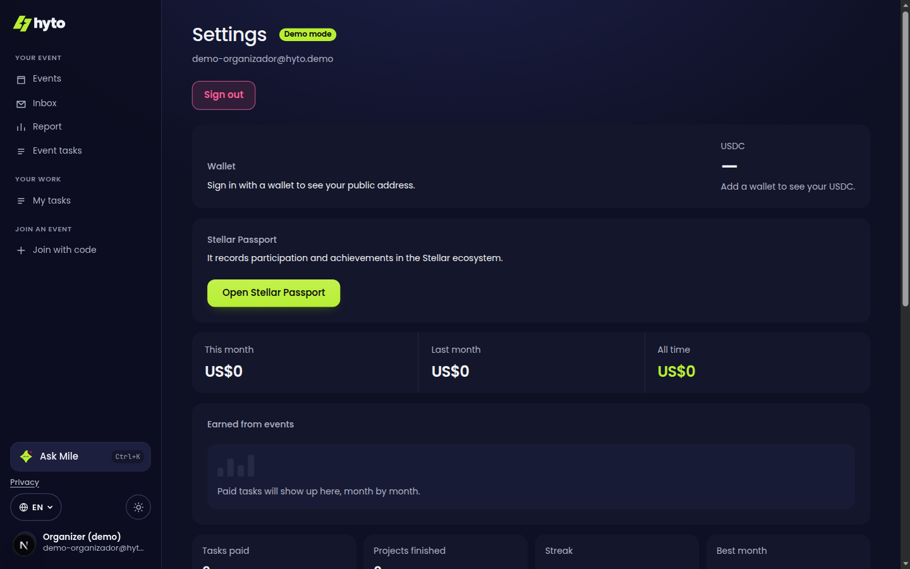

<p align="center">
  
</p>

<h1 align="center">Hyto</h1>

<p align="center">
  <strong>Proof before payout.</strong><br />
  Pay anyone, anywhere, for work you can't see in person, and prove where every dollar went.
</p>

<p align="center">
  <a href="https://tryhyto.com"><strong>Website</strong></a> ·
  <a href="https://hyto.vercel.app"><strong>App</strong></a> ·
  <a href="#testnet-proof"><strong>Testnet proof</strong></a> ·
  <a href="https://x.com/tryhyto"><strong>X</strong></a>
</p>

<p align="center">
  
  
  
  
</p>

---

## What we build

Every day, money is sent to people far away to get something done: a company paying field workers, an NGO funding a local project, a sponsor backing an event in another country, a grant released in stages, a remote team paying contractors. Today that runs on trust, invoices and screenshots. The payer can't check the work, the worker waits to get paid, and nobody can easily prove what was paid, for what, and to whom.

Hyto locks the money per task, collects the proof, and releases each payment only after a person approves it, all on a public Stellar trail anyone can audit.

> **The core question:** *What has to be proven before the money moves?*

Stellar is the settlement rail, not the audience. People sign in with an email and never install a wallet or a crypto app.

---

## How it works

| Step | What happens |
| :---: | :--- |
| **1. Lock** | The payer creates a project with tasks and locks the budget in USDC in a **[Trustless Work](https://trustlesswork.com)** multi-release escrow (escrow-as-a-service on Stellar: non-custodial smart-contract escrows that hold funds until each milestone is approved). One milestone per task. |
| **2. Join** | Workers join with a code or an invite and sign in with email, Google or Apple through **[Cavos](https://cavos.xyz)** (embedded wallets: a Stellar wallet created from a normal login). No seed phrases. |
| **3. Prove** | For each task, the worker uploads evidence: a live photo of the work, a receipt in any currency, or a document. |
| **4. Review** | **Mile**, Hyto's AI reviewer (Qwen vision + Laya scoring), checks the evidence against the task and the payer's rules, explains what is missing, and recommends *Met*, *Partial* or *Not enough*. **Mile never signs or moves money.** |
| **5. Release** | A person approves, and the milestone is released in USDC straight to the worker's wallet. Every payment links to Stellar Expert. |

---

## Testnet proof

The first successful `release_funds` on Stellar testnet, seen on Horizon at `2026-10-11T01:40:02Z` (10 October 2026, about 7:40 p.m. Costa Rica):

| | |
| :--- | :--- |
| **Transaction** | [`731d4ab4fd30…dc359a`](https://stellar.expert/explorer/testnet/tx/731d4ab4fd30d30759eb228a525c9a8e9b50c96e3a26672dc6f6cee39fdc359a) |
| **Escrow contract** | [`CA7PNU3THJWZ…PXNN4R`](https://stellar.expert/explorer/testnet/contract/CA7PNU3THJWZUIMAGSTDCPSKZ5LXLLDLTYWM6XURWJSMCRN6BDPXNN4R) |

> [!NOTE]
> This payment is on **testnet**, not mainnet. There is no pilot and no mainnet payment yet. The amounts in the ZEEK sample (three US$20 work tasks and a US$15 meal cap) are seed examples, not real money or real wallets. Inside the public demo (demo login at [hyto.vercel.app](https://hyto.vercel.app)) the payment is simulated and resets for everyone.

---

## Screens

<table>
  <tr>
    <td width="33%"></td>
    <td width="33%"></td>
    <td width="33%"></td>
  </tr>
  <tr>
    <td align="center"><sub>Events, as the organizer</sub></td>
    <td align="center"><sub>Review with Mile (money controls off in the demo)</sub></td>
    <td align="center"><sub>Account, nothing paid yet</sub></td>
  </tr>
</table>

---

## What's inside

- **No global roles.** Whoever creates an event and can cover the budget plus a 1 USDC reserve becomes that event's organizer. Others join with a direct invite or a `HYTO-` code; invites expire in 7 days.
- **Organizer:** create the project, assign tasks at `/eventos/[id]/tareas`, review evidence, confirm reimbursement amounts, lock the budget and pay.
- **Member:** sees only their own tasks, uploads evidence, and follows each payment to the chain.
- **Event context for Mile:** organizers can tell Mile about the event and set the rules evidence must meet. Volunteers never see it.
- **Light and dark themes, English and Spanish.**
- **Behind flags (off until their migrations are applied):** `HYTO_COMUNIDADES`, `HYTO_TABLON`, `HYTO_TIPO_CUENTA`, `HYTO_PERFIL_VOLUNTARIO`.

---

## Built with

| Layer | Stack |
| :--- | :--- |
| App | Next.js 16 (App Router), React 19, TypeScript (strict), Tailwind 4 |
| Data | Neon Postgres, Drizzle schema, Vercel Blob (private) |
| Payments | Stellar SDK, Trustless Work escrow v2, USDC on testnet |
| Identity | Cavos embedded wallets (email OTP, Google, Apple, passkeys) |
| AI review | Groq / Qwen vision with Gemini fallback, Laya scoring |
| Hosting | Vercel (production on `main`, a preview for every pull request) |

---

## Run it locally

```bash
npm ci
npm run dev
```

Checks:

```bash
npm test          # *.test.ts under lib/, scripts/backend-traspaso and tests/integracion (tsx)
npx tsc --noEmit
npm run build
```

There is no ESLint. `npm run test:integracion` talks to Postgres and runs separately.

Local database and escrow scripts:

```bash
npm run db:local
npm run db:migrar
npm run db:semilla
npm run verificar:entorno
npm run hito
```

- `db:migrar` applies `drizzle/*.sql` in filename order.
- `db:semilla` loads the ZEEK sample.
- Do not migrate or seed production without the database owner's go-ahead. Set `HYTO_CONFIRMAR_BASE_PRODUCCION=si` only when that is intended.
- `npm run hito` is a standalone escrow script. Without `TRUSTLESS_API_KEY` it does not pay.

**Deploy and environment.** A push to `main` deploys production on Vercel, and every pull request gets a preview. Secrets live in Vercel only, never in the repo. The only public variable is `NEXT_PUBLIC_CAVOS_APP_ID`. Variable names are listed in [AGENTS.md](AGENTS.md) and [.env.example](.env.example).

---

## Docs

| File | What it is |
| :--- | :--- |
| [AGENTS.md](AGENTS.md) | Current product, code map and open issues. **Read this first.** |
| [STACK.md](STACK.md) | Stack and how a payment moves. |
| [ROLES.md](ROLES.md) | Event membership and how the team splits work. |
| [PLAN.md](PLAN.md) | What is left. |
| [CHANGELOG.md](CHANGELOG.md) | What landed. |
| [Hyto-informe.md](Hyto-informe.md) | The pitch the team reuses. |
| [docs/AUDIT-2026-09-30.md](docs/AUDIT-2026-09-30.md) | Security audit against `db82b93`, with a status note for `2b9fad4`. |
| [docs/auditorias/2026-10-02-ramp-adaptation.md](docs/auditorias/2026-10-02-ramp-adaptation.md) | Research on Ramp Network (crypto on/off-ramp). Not part of the demo. |

---

## Team

| | Focus |
| :--- | :--- |
| **Josué Valles** · [@jxsu404](https://github.com/jxsu404) | Admin app and backend, Vercel and Neon |
| **Sebastián Ceciliano** · [@Cbiux](https://github.com/Cbiux) | Escrow and wallets: Trustless Work, Cavos, USDC release |
| **Abdiel** · [@abdxcole](https://github.com/abdxcole) | UX/UI, brand, social and pitch |
| **Raúl** · [@Milasur](https://github.com/Milasur) | Member app, evidence and Mile's review |
| **Esteban** · [@Psybre](https://github.com/Psybre) | Backend foundations |

---

<p align="center">
  Built in Costa Rica 🇨🇷 for anyone, anywhere.<br />
  <sub>Find Your Way hackathon · Stellar</sub>
</p>
